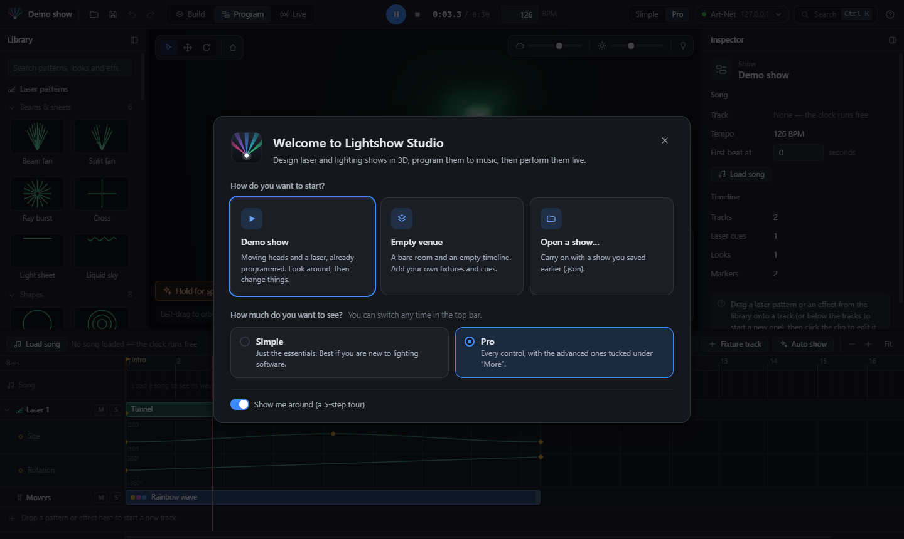
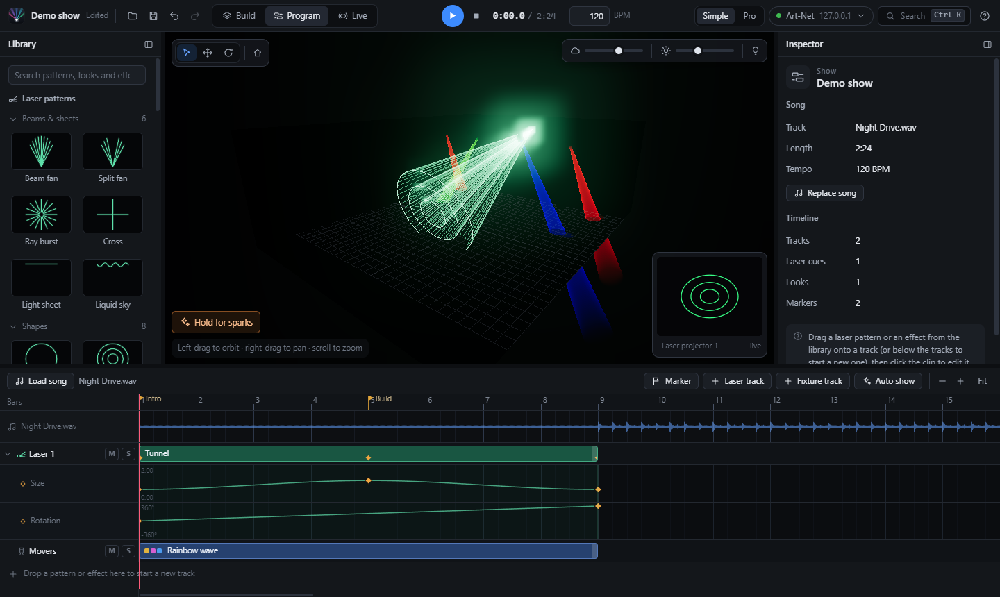
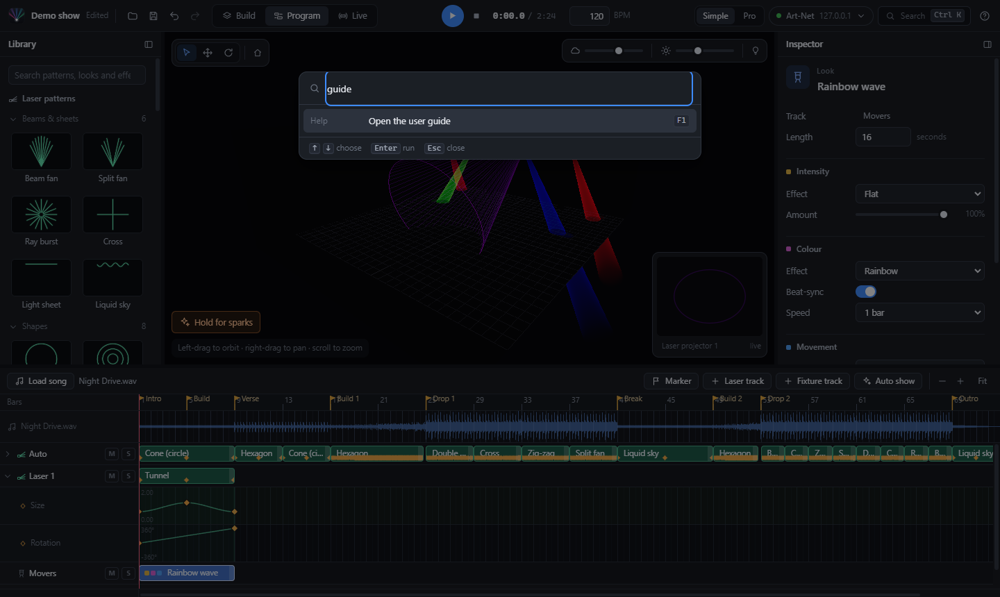

# Getting started

## Install

1. Download **`LightshowStudio-Setup-x.y.z.exe`** from the
   [latest release](https://github.com/Royalkiller2222/Lightshow-Studio/releases/latest).
2. Run it. It installs for your Windows user (no admin rights needed), adds
   Start-menu and desktop shortcuts, and opens the app. Running a newer
   installer later updates the app in place.

Windows may say **"Windows protected your PC"** because the installer isn't
code-signed yet. Click **More info → Run anyway**.

On first launch, Windows Firewall asks whether the app may use the network.
Allow it if you want to send DMX to real lights.

## The welcome screen

The first time you open the app, a welcome screen asks two things:

- **How to start**: the **Demo show**, an **Empty venue**, or **Open** a show
  you saved before.
- **Simple or Pro**: how much of the interface to show (see below). You can
  switch at any time in the top bar.

Tick **Show me around** for a 5-step tour of the window. Both the welcome
screen and the tour can be opened again from **?** in the top bar.

The demo has four moving heads sweeping coloured beams through haze, and a
laser drawing a spinning, breathing tunnel. With no song loaded, the
16-second demo loops.

## The window

- **Top bar**, left to right:
  - the show's name, Open, Save, Undo and Redo
  - the three **workspaces**: Build, Program and Live
  - Play/pause, Stop, the clock and the tempo (BPM)
  - the **Simple / Pro** switch
  - the **output pill**, which shows where DMX is going (click it to change)
  - **Search** (Ctrl+K)
  - **?** for shortcuts, the tour and this guide
- **Library** (left): what you can add. That's fixtures in Build, and laser
  patterns, looks and effects in Program.
- **3D view** (centre): the venue, with your rig and the show playing in haze.
- **Inspector** (right): edits whatever you selected, such as a fixture, a cue,
  a track or a marker. With nothing selected it shows the venue (Build) or
  the show (Program).
- **Bottom area**: the patch sheet in Build, the timeline in Program.

Drag the borders between panels to resize them. Each panel's header has a
button to hide it. Search (Ctrl+K) can show it again.

### The three workspaces

| Workspace | What it's for | Keys |
| --- | --- | --- |
| **Build** | Set up the venue and the rig: place fixtures, patch them | Ctrl+1 |
| **Program** | Write the show on a timeline, to a song | Ctrl+2 |
| **Live** | Play the show: jump between sections, masters, blackout, Auto | Ctrl+3 |

## Simple and Pro

- **Simple** shows only the essentials.
- **Pro** adds DMX addresses, exact times and every advanced control. Many of
  those sit under a **More** heading that you can open and close.

Nothing is lost when you switch. Pro-only settings keep their values, and the
show plays the same either way.

## Moving around the 3D view

- **Left-drag** orbits the camera, **right-drag** pans and **scroll** zooms.
- The camera button in the view's toolbar resets the view.
- The same toolbar has the **Select**, **Move** and **Rotate** tools (V, X, C).
- Use **Haze**, **Room light** and **House light** to change how the room looks.
  Beams only show where there's haze for them to light up.

## Search: every command in one box

Press **Ctrl+K** and type a few letters. Search finds every command in the
app, for example:

- add a fixture, a pattern or a look
- go to a marker
- switch workspace
- import a file
- open the output settings

Use **↑ / ↓** to choose a command and **Enter** to run it.

## Saving and opening

- **Ctrl+S** saves the show as a `.json` file.
- **Ctrl+O** opens one.

A show file holds the rig, the venue, the timeline, palettes, imported laser
patterns and Auto settings.

**The song itself is not stored in the show file**, only its name. After
opening a show, load the same song again in Program (**Load song**) to hear
it. Auto's section edits come back once the same song is loaded.

Everything you change can be undone: **Ctrl+Z** undoes and **Ctrl+Y** redoes.
The Live masters and blackout are the exception. They are performance
controls, so they aren't saved and aren't undone.

Next: [Your first show](02-your-first-show.md)
