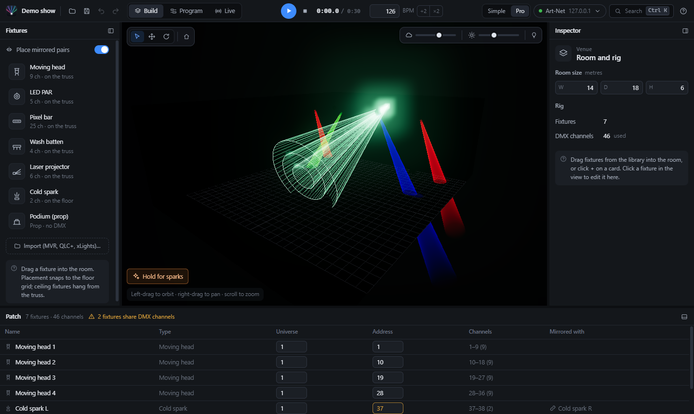
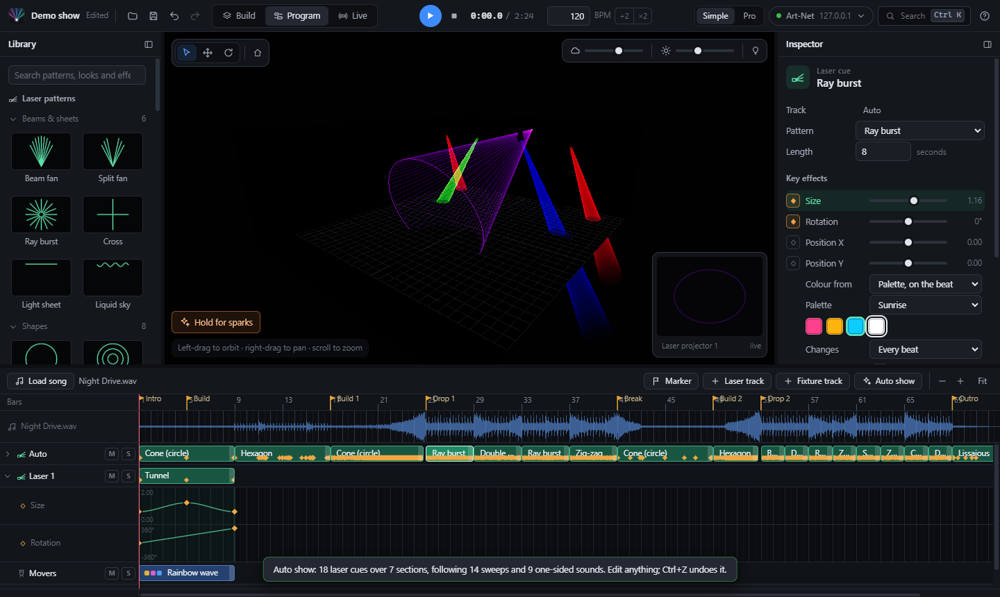

# Your first show

This walk-through takes you from an empty room to a show you can perform.
You'll need a song file (mp3, wav, ogg or m4a).

## 1. Start with an empty venue

Open **?** → **Welcome screen** (or Ctrl+K → "New show") and pick **Empty
venue**. You get a bare room and a timeline with two tracks: **Laser 1** and
**Lights**.

## 2. Build the rig

In **Build** (Ctrl+1), the library on the left lists the fixture types.

1. Drag a **Laser projector** into the room. With **Place mirrored pairs** on
   (the default), you get two, mirrored across the centre line.
2. Drag in two **Moving heads** the same way.
3. Click a fixture to edit it in the inspector: name, position, facing.
   With the **Move** tool (X) you can drag it around the room. Its mirrored
   twin follows.

Every fixture gets a DMX address automatically; the patch sheet at the
bottom lists them. See [The rig](03-the-rig.md) for the details.

## 3. Load your song

Switch to **Program** (Ctrl+2) and click **Load song** above the timeline.
The app listens to the song for a moment, then the waveform appears with
the tempo and the first downbeat found, so cues snap to the beat and bar
lines match the music.

Check the BPM in the top bar. If the grid counts twice as fast or half as
fast as you do, press **×2** or **÷2** next to it. If the bar lines drift
from the beat, type the right tempo there.

## 4. Add laser cues

The library now shows **laser patterns**, grouped as Beams, Shapes, Waves and
Graphics, each with a live thumbnail.

1. Drag **Tunnel** onto the **Laser 1** track at the start of the song.
2. Click the cue. The inspector shows its **Key Effects**: Size, Rotation,
   Position, Colour and Brightness.
3. Change the colour, and drag the cue's right edge to make it longer.
4. Add a few more patterns along the track. Press **Space** to play.

### Make it move: keyframes

1. Put the playhead at the start of a cue and press the **◆** next to
   **Size**. That sets a keyframe.
2. Move the playhead later in the cue and change Size. A second keyframe
   appears, and the size now animates between them.
3. Click the arrow on the track header to open its curve lanes and drag the
   points right under the music.

More in [Laser cues](05-laser-cues.md).

## 5. Light the rig with a look

Drag a look such as **Rainbow wave** from the library onto the **Lights**
track. Looks drive your fixtures (moving heads, PARs, bars), while laser cues
drive the projectors. See [Fixture looks](06-fixture-looks.md).

## 6. Mark the sections

Play the song and press **M** at the start of each part: intro, verse,
drop. Click a marker and name it in the inspector, or double-click the ruler
to add one where you click. Markers become the pads in Live.

## 7. Or let Auto write it

Click **Auto show** above the timeline. It listens to the whole song, finds
the intro, builds, drops and breaks, and writes an editable laser show with
markers. You can generate it, then change anything by hand. See
[Auto](07-auto.md).

## 8. Play it live

Switch to **Live** (Ctrl+3). Each marker is a pad: click it or press **1–9**
to jump there. The masters on the right set brightness, speed and size;
**B** is blackout and **F** is fullscreen. See [Live](08-live.md).

## 9. Save

Press **Ctrl+S**. Remember that the song isn't inside the show file; keep
it next to the show and load it again after opening.
