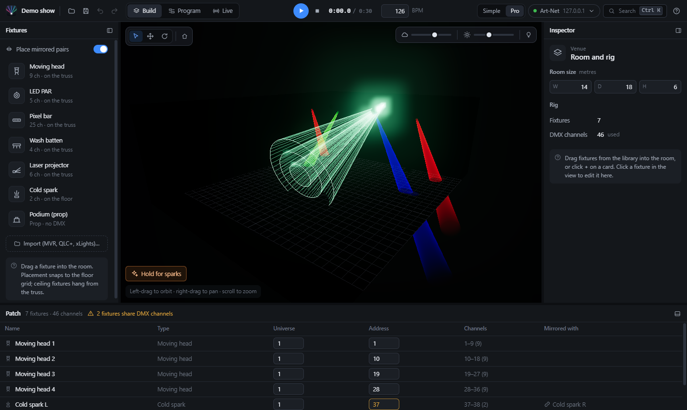
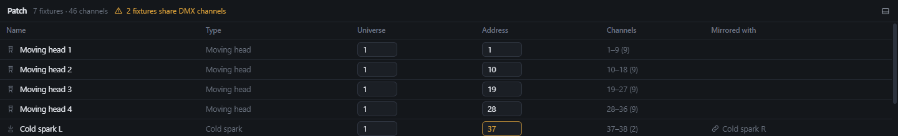

# The rig (Build)

The **Build** workspace (Ctrl+1) is where you set up the venue and the
fixtures in it.

## Fixture types

| Type | What it does | Hangs on | DMX channels |
| --- | --- | --- | --- |
| **Moving head** | A spot beam that pans, tilts, changes colour and zooms | Truss | 9: Pan, Pan fine, Tilt, Tilt fine, Dimmer, Red, Green, Blue, Zoom |
| **LED PAR** | A fixed colour wash pointing where it's mounted | Truss | 5: Dimmer, Red, Green, Blue, Strobe |
| **Pixel bar** | A bar of 8 colour cells, so chases and rainbows run along it | Truss | Dimmer, then Red/Green/Blue for each cell |
| **Wash batten** | A long bar that throws one wide, soft colour | Truss | 4: Dimmer, Red, Green, Blue |
| **Laser projector** | Draws your laser cues (see below) | Truss | 6: Dimmer, Red, Green, Blue, Speed, Spread |
| **Cold spark** | A spark fountain on the floor | Floor | 2: Trigger (above 127 fires), Height |
| **Podium (prop)** | A stage riser; no light | Floor | none |

**Laser cues are visual only for now.** A laser projector draws your laser
cues in the 3D view and the output preview, but laser cues don't send DMX or
ILDA to a real laser yet. The projector's own six DMX channels do work, for
example when a console drives it. See [DMX output](10-dmx-output.md).

## Placing fixtures

- **Drag** a fixture from the library into the room, or click its **+** to
  add one.
- Placement snaps to the floor grid. Truss fixtures hang from the truss and
  floor fixtures stand on the floor.
- **Place mirrored pairs** (on by default) drops two fixtures, mirrored
  across the centre line. Move or turn one and its twin follows.

### The tools

| Tool | Key | Use |
| --- | --- | --- |
| Select | V | Click a fixture to select it |
| Move | X | Drag a fixture to move it |
| Rotate | C | Drag to turn a fixture, in 45° steps |

**Del** removes the selected fixture and **Esc** deselects.

## The fixture inspector

Click a fixture to edit it:

- **Name**.
- **Position** in metres. **X** is left–right, with 0 on the centre line.
  **Y** is height. **Z** is front–back, and negative values are towards the
  back.
- **Facing** in degrees, in 45° steps. **Tilt** and **Roll** are under
  **More rotation**.
- **Mirror** (Pro): shows which fixture is its twin. **Unlink the pair** to
  move them separately.
- **DMX** (Pro): universe, start address, channel count and profile.
- **Remove fixture**.

### Laser output (laser projectors only)

Each projector has its own output settings. They're applied after the cue's
own values, so one show can fit projectors of different sizes and places.

- **Size** (0–2): scales everything the projector draws.
- **Brightness limit**: caps this projector's brightness.
- **Flip left–right** and **Flip up–down**: for projectors hung backwards
  or upside down.
- **Position X / Y** (under **More output**): shifts the whole output.
- **Reset** puts these back to normal.

## The patch sheet

The bottom panel lists every fixture. Simple mode calls it **Fixtures**;
Pro mode calls it **Patch**.

| Column | Meaning |
| --- | --- |
| Name, Type | Click a row to select the fixture |
| Universe, Address, Channels | Pro only. Edit the address here |
| Mirrored with | Its twin, if it has one |

- New fixtures are patched automatically to the next free addresses.
  Addresses run from 1 to 512.
- If two fixtures share channels, the sheet warns: **"N fixtures share DMX
  channels"**. Move one of them to free addresses.
- Two fixtures of the same type can share an address on purpose: they then
  always do the same thing. The demo's two cold sparks share address 37 this
  way, so the demo shows the warning. That one is safe to ignore.

## The venue

With nothing selected, the inspector shows the **venue**:

- **Room size**: width, depth and height in metres (3 m minimum).
- **Rig**: how many fixtures there are and how many DMX channels they use.

The 3D view's toolbar sets the atmosphere:

- **Haze**: beams only show where there's haze to scatter the light.
- **Room light**: how much of the venue you can see.
- **House light**: floods the venue so you can see the rig.

Haze, room light and house light are saved with the show.

## Importing a rig

The **Import** button at the bottom of the library brings in a rig from an MVR
file, a QLC+ workspace or an xLights sequence. See [Importing](09-importing.md).
