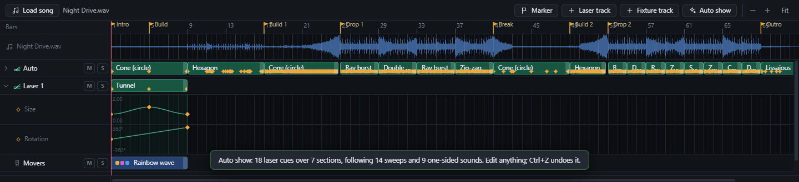

# The timeline (Program)

The **Program** workspace (Ctrl+2) is where you write the show. The timeline
along the bottom works like a music editor: the song runs left to right, and
your cues sit on named tracks underneath it.

## The parts of the timeline

- **Ruler**: bars and beats, your section markers and the playhead. Click it
  to move the playhead.
- **Song**: the waveform of the loaded song. Click it to move the playhead.
- **Tracks**: one row each, holding cue clips. The header shows the track's
  name, **M** (mute) and **S** (solo).
- The buttons above the timeline are **Load song**, **Marker**, **Laser track**,
  **Fixture track**, **Auto show** and the zoom controls (**−**, **+**, **Fit**).

## The song

Click **Load song** (mp3, wav, ogg or m4a). The app:

- draws the waveform
- listens for the tempo (BPM) and the first downbeat, so the bar lines and
  snapping follow the music and bar 1 starts where the music does
- makes the show as long as the song

Listening takes a second or two; a message says so, then tells you the
tempo it found.

If the tempo is wrong:

- **Twice too fast or too slow** (the most common miss, such as 82 against
  164): press **÷2** or **×2** next to the BPM in the top bar. When the
  song could be counted either way, the "Loaded" message points at the
  button.
- **Anything else**: type the right tempo in the BPM box. Decimals are
  kept (127.95).
- **The bar lines sit between the beats, or bar 1 is on the wrong beat**:
  in Pro, the show inspector (click empty timeline space) has **Bar 1
  starts at**, in seconds.

A tempo you set by hand is saved with the show and kept when you load the
same song again.

Without a song, the timeline is a 30-second window that grows as you add
cues.

## Tracks

There are two kinds of track:

- **Laser tracks** hold laser cues. Each one plays on **all** your laser
  projectors, or only the ones you tick.
- **Fixture tracks** hold looks and effects. Each one drives a **fixture
  group**: Movers, LED PARs, Bars, Lasers, Cold sparks, All fixtures, or
  Selection (whatever is selected in the 3D view).

Click a track's header to edit it in the inspector. **Double-click its name to
rename it.**

| Setting | What it does |
| --- | --- |
| Name | Shown in the header |
| Projectors / Fixtures | What the track plays on. If a laser track plays on no projector, the inspector warns you |
| Mute | Silences the track |
| Solo | Plays only the soloed tracks |
| Move up / Move down | Changes which track wins (see below) |
| Delete track | Removes the track and its cues |

### Which track wins

When cues overlap in time:

- **Laser tracks**: the higher track wins.
- **Fixture tracks**: the higher track wins colour and position. For
  brightness, the brightest value wins (HTP, as on a lighting desk).

## Cues

- **Add a cue**: drag a pattern, look or effect from the library onto a
  track. Drop it below the tracks to start a new track. You can also
  double-click a library item (or select it and press Enter) to add it at the
  playhead.
- **Move a cue**: drag it. It snaps to the beat; hold **Shift** to place it
  freely.
- **Resize a cue**: drag its right edge.
- **Edit a cue**: click it and use the inspector.
- **Delete a cue**: select it and press **Del**, or use **Delete cue** in the
  inspector.

A laser pattern dropped on a fixture track (or a look on a laser track)
starts a new track of the right kind instead.

## Markers

Markers name the parts of the song, such as Intro, Verse, Build and Drop.
They become the pads in [Live](08-live.md).

- **Add**: press **M** at the playhead, click **Marker**, or double-click the
  ruler.
- **Move**: drag it along the ruler. It snaps to the beat; hold **Shift** to
  place it freely.
- **Edit**: click it to name it in the inspector, see which bar it's on (and
  its exact time, in Pro), jump to it or delete it.

## Zoom and scroll

- **Ctrl + wheel** zooms, as do the **−** and **+** buttons.
- **Fit** shows the whole show.
- **Shift + wheel** or the scrollbar scrolls. While playing, the view
  follows the playhead.

## Keyframe curves

Laser tracks can open (the arrow at the left of the header) to show a curve
lane for each animated Key Effect. See
[Laser cues → Shaping curves](05-laser-cues.md#shaping-curves-on-the-timeline).

## The show inspector

Click empty space on the timeline to see the show:

- the song, its length and tempo, and **Load / Replace song**
- how many tracks, laser cues, looks and markers you have
