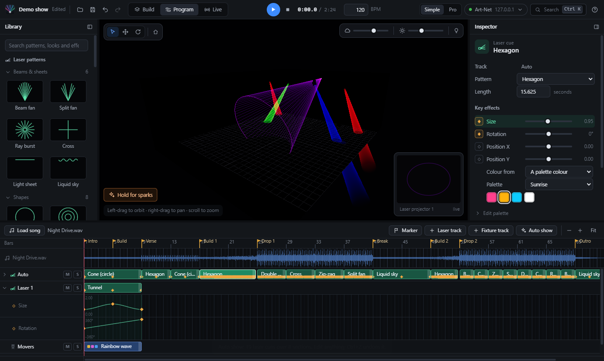
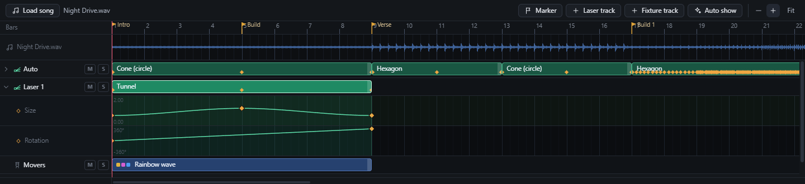

# Laser cues

A laser cue is a **pattern** played for a stretch of time, with seven
**Key Effects** (size, rotation, position, colour and more) that can each
change over the cue with keyframes. If you've used Pangolin BEYOND, this
will feel familiar.

## Patterns

The library in Program shows every pattern as a live thumbnail, in groups:

| Group | Patterns |
| --- | --- |
| **Beams** | Beam fan, Split fan, Ray burst, Cross, Light sheet, Liquid sky |
| **Shapes** | Cone (circle), Tunnel, Double tunnel, Square, Triangle, Hexagon, Star, Heart |
| **Waves** | Wave, Double wave, Wave stack, Zig-zag, Figure eight, Lissajous, Spiral |
| **Graphics** | Grid, Scan lines, Dot field, Text |
| **Imported** | ILDA files you've imported (see [Importing](09-importing.md)) |

The search box at the top of the library filters the list. Drag a pattern
onto a laser track, or double-click it to add it at the playhead.

- **Text** draws the words you type in the cue's **Text** box (A–Z, 0–9).
- **Imported** patterns can be animated. The cue shows a **Frame rate** box
  that sets how fast the file's frames play.

To change the pattern of an existing cue, pick another one in the inspector's
**Pattern** menu. Its settings stay.

## Key Effects

| Key Effect | What it does |
| --- | --- |
| **Size** | 0 (a dot) to 2 (double size) |
| **Rotation** | Turns the pattern around its centre |
| **Position X / Y** | Moves the pattern across the projection area |
| **Colour** | The beam colour, or a palette (see below) |
| **Brightness** | 0–100% |
| **Tilt X / Y** (Pro, under More effects) | Tips the pattern in 3D |
| **Visible points** (Pro, under More effects) | Draws only part of the pattern; animate it to make the pattern grow |
| **Scan rate** (Pro, under More effects) | Lower values draw the pattern sparser, as dots |

Some imported patterns have their own colours. Their Colour then **tints**
them, and white keeps their own colours.

## Keyframes

Every Key Effect can change over the cue:

1. Move the playhead into the cue.
2. Press the **◆** next to a Key Effect to set a keyframe there.
3. Move the playhead and change the value. Once a Key Effect has keyframes,
   **every change you make writes a keyframe** at the playhead.

- A Key Effect that has keyframes is marked in the list.
- Keyframes are placed relative to the cue, so **resizing a cue stretches
  its animation** with it.
- **Auto-key** (Pro, in the Key Effects header) makes every change write a
  keyframe, even on Key Effects that don't have any yet.
- While the show plays, keyframes snap to the half-beat. Tap ◆ on the beat to
  record in time with the music.
- **Clear** removes the selected Key Effect's keyframes and keeps its current
  value.
- **Easing** (Pro) sets how the value moves between keyframes:
  - **Linear** moves at a steady speed.
  - **Smooth** eases in and out.
  - **Step** holds the value, then jumps to the next one.

### Shaping curves on the timeline

Click a Key Effect's name in the inspector to show its curve on the timeline.
You can also open the laser track with the arrow on its header. Each animated
Key Effect gets a lane under the track, lined up with the music.

- **Click** in a lane to add a keyframe; drag up and down to set its value.
- **Drag** a keyframe to move it. It snaps to the half-beat; hold **Shift** to
  place it freely.
- **Double-click** a keyframe, or select it and press **Del**, to remove it.

## Palettes

Instead of a fixed colour, a cue's colour can come from a **palette**: a
short list of colours saved with the show. New shows start with **Ice**,
**Fire** and **Club RGB**.

Set **Colour from** in the inspector to one of:

- **Its own colour**: the Colour Key Effect, as normal.
- **A palette colour**: one colour from a palette. Click a swatch to choose
  it.
- **Palette, on the beat**: the colours take turns in time with the music.
  **Changes** sets how often (every ½ beat, beat, 2 beats, bar or 2 bars),
  and **Fade** blends from one colour to the next.

Open **Edit palette** to rename it, change its colours, add a colour or
remove the last one. Choose **New palette…** in the Palette menu to make
your own. **Every cue that uses a palette changes with it.** That's the point:
recolour a whole show in one place.

## Projectors

Each laser track plays on all your laser projectors, or only the ones you
tick in the track's inspector. Two tracks on different projectors can play
different patterns at the same time.

Each projector also has its own output settings (size, brightness limit,
flips, position); see [The rig → Laser output](03-the-rig.md#laser-output-laser-projectors-only).

### The output preview

In Program and Live, the bottom-right of the 3D view shows a flat preview of
what a projector draws. Pick which projector it shows in its menu.

> Laser cues are visual only for now. They play in the 3D view and the
> preview, but aren't sent to a real laser yet.
