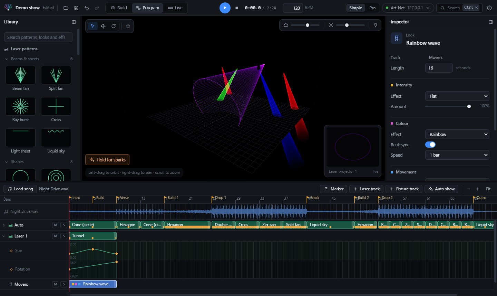

# Fixture looks

Laser cues drive laser projectors. **Looks** drive everything else: moving
heads, LED PARs, pixel bars, battens and cold sparks. Most shows mix the two.

A look lives on a **fixture track**. The track decides *which* fixtures it
drives (a group such as Movers or All fixtures), and the look decides *what
they do*.

## Layers

A look has up to three **layers**, one for each thing a light can do:

| Layer | Effects |
| --- | --- |
| **Intensity** | Flat, Wave, Audio band, Chase, Cold sparks |
| **Colour** | Static, Rainbow, Two-colour |
| **Movement** | Static, Circle, Wave |

Each layer can also be **None**. A look with only a Colour layer, for
example, changes colour and leaves brightness and movement to other tracks.

## Ready-made looks

The library's **Looks** section has seven starting points:

| Look | What it does |
| --- | --- |
| **Rainbow wave** | Full brightness, a rainbow fanned across the rig, a slow pan wave |
| **Bass hits** | Flashes on the kick, deep red |
| **Circle chase** | One-by-one chase in two colours, circling |
| **Pulse sweep** | A beat pulse fanned across the rig, cyan sweep |
| **Warm wash** | Steady amber, pointed down |
| **White strobe** | Fast white flashes |
| **Spark burst** | Fires the cold-spark machines |

Drag one onto a fixture track, then change it in the inspector. Below the
looks, the library lists every **single effect**. Drop one onto a look
to swap that layer, or onto a track to make a one-layer look.

## Effect controls

Each effect shows only the controls it uses:

| Control | Meaning |
| --- | --- |
| **Colour**, **Colour 2** | The colours used |
| **Amount** | How strong the effect is (brightness, size of the movement) |
| **Beat-sync** | On: the speed follows the music. Off: a fixed rate in Hz |
| **Speed** | With Beat-sync: 1 bar, 1/2, 1 beat, 1/8 or 1/16. Without: 0.05–8 Hz |
| **Follows** | Audio band only: Bass, Mids or Highs |
| **Pan**, **Tilt** | Where Static movement points the heads |

Under **More** (Pro):

| Control | Meaning |
| --- | --- |
| **Wave shape** | Sine, Triangle, Ramp up, Ramp down, Square / PWM or Random |
| **Floor** | The lowest point of the wave, so lights don't go fully dark |
| **Spread** | Offsets the fixtures from each other, so the effect ripples across the rig |
| **Spread mode** | **Tail**: from one end to the other. **Symmetric**: from the middle outwards |
| **Direction** | Forward or Reverse |
| **Duty** | For square waves: how much of each cycle is "on" |

The look's **name** fills itself in from its layers until you type your own.
**Length** is in seconds; dragging the cue's edge on the timeline works too.

## How overlapping looks combine

When two fixture tracks drive the same fixture at the same time:

- **Brightness**: the brightest wins (HTP).
- **Colour and movement**: the higher track wins (LTP).

So you can keep a steady colour look on one track and lay a strobe on a track
above it for the drop. Order tracks with **Move up / Move down** in the track
inspector.

## Cold sparks

Cold-spark machines fire from a **Cold sparks** effect (Intensity layer,
**Amount** sets the height), from the **Spark burst** look, or by hand with
**Hold for sparks** in the 3D view or in Live.
