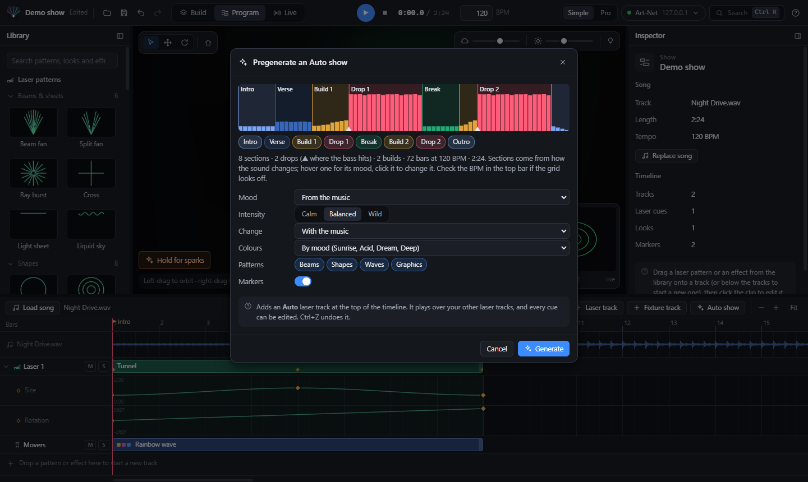
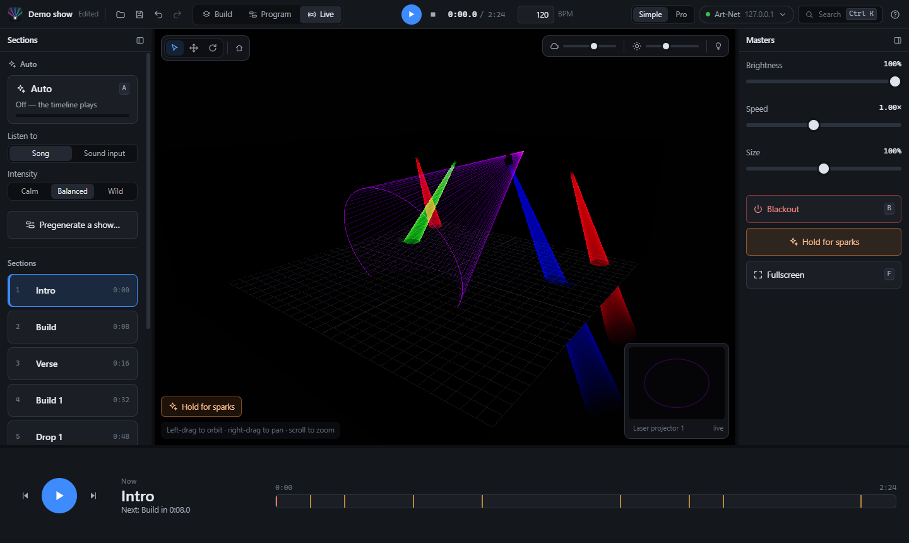

# Auto

Auto turns music into a laser show. It works two ways:

- **Pregenerate** listens to the whole song first, then writes a complete,
  editable laser show onto the timeline. Use this for shows you plan ahead.
- **Live Auto** reacts to the music as it plays, from the loaded song or from
  a microphone or line-in. Use this when you don't know the music in advance.

Both use the same settings, which are saved with the show.

## Pregenerate a show

Load a song in Program, then click **Auto show** above the timeline. You can
also click **Pregenerate a show…** in Live, or search "Pregenerate" with
Ctrl+K.

### What Auto heard

The chart shows the song's **energy, bar by bar**, coloured by section. The
**▲** marks show where each drop hits. Underneath, the section chips name
each part:

| Section | What Auto listens for |
| --- | --- |
| **Intro** | The quieter start |
| **Verse** | Steady parts between the big moments |
| **Build** | Rising tension: getting louder, brighter and busier towards a drop |
| **Drop** | The big moment, usually where the bass comes in hard |
| **Break** | A calm-down after a drop |
| **Outro** | The end |

Sections that repeat (the second chorus or drop) are recognised, so they get
a matching look. Hover a chip to see its time and **mood**.

Below the chips, a summary line counts the sections, drops and bars, and
shows the BPM. **If the grid looks off, check the BPM in the top bar first.**
Auto needs the right tempo to find the bars.

### Correcting the sections

Auto works from rules and can get a song wrong. Fix it before you generate:

1. Click a section, either its chip or its part of the chart.
2. Change its **Type**. The type Auto heard is marked "(heard)".
   - Make it a **Drop** and it opens like one: a dark beat before it, then a
     big hit.
   - Make it a **Build** and it becomes one rising cue.
3. Change its **Mood**: Euphoric, Aggressive, Dreamy or Dark, or leave it on
   the music's (or the show's) mood. **A section's own mood beats the
   show's overall Mood**, so you can make a Dreamy show with one Aggressive
   drop.

Changed sections get a dot. **Reset** puts one section back the way Auto
heard it, and **Undo all section changes** resets them all. Section names and
markers renumber themselves (Drop 1, Drop 2…).

Your changes are saved with the show and can be undone. They belong to the
song: a different song starts with a clean map.

### Settings

| Setting | Choices |
| --- | --- |
| **Mood** | **From the music** (each section gets its own mood) or one mood for the whole show: Euphoric, Dark, Dreamy, Aggressive. The mood sets the colours, the patterns that suit it and the pace |
| **Intensity** | Calm, Balanced or Wild: how much movement, how fast things change, how energetic the patterns are |
| **Change** | **With the music** (often in drops, rarely in calm parts) or every 1, 2, 4 or 8 bars |
| **Colours** | **By mood** (Sunrise, Acid, Dream, Deep; live Auto uses Ice, Fire and Club) or one of your palettes |
| **Patterns** | Which groups Auto may use: Beams, Shapes, Waves, Graphics, and Imported if you have ILDA files. Text is never used |
| **Pairs** | With two or more projectors: odd and even projectors get different patterns, spinning opposite ways |
| **Markers** | Adds a marker for each section, which become pads in Live |

### Generate

Click **Generate**. Auto adds an **Auto** laser track at the top of the
timeline. With **Pairs** it adds two: **Auto A** and **Auto B**. The track
plays over your other laser tracks. Every cue is an ordinary laser cue that
you can edit, move or delete.

What Auto does with the song:

- Looks change on musical phrases.
- Builds rise, then drop to a dark beat just before the drop.
- Drops hit with every projector in unison, a flash and a pop.
- The biggest drop gets the best.

**Generate a new take** writes a fresh variation. It **replaces the earlier
Auto tracks, including any edits you made to them**. Ctrl+Z undoes a
generate.

## Live Auto

In **Live**, the **Auto** pad (or **A**) hands the lasers to the music.

- **Listen to**:
  - **Song**: the track loaded in Program.
  - **Sound input**: a microphone or line-in, for music playing from
    somewhere else, such as a DJ mixer.
- The pad shows a level meter and what Auto is doing right now.
- While Auto is on, it drives **every laser projector** instead of your laser
  tracks. **Fixture looks keep playing** from the timeline.
- Live Auto keeps its own beat clock, so it carries on with the timeline
  stopped. If it hears nothing, it follows the beat from the BPM.
- In Live, the settings show Intensity in Simple mode, and also Change,
  Colours, Patterns and Pairs in Pro mode.

Turning Auto on or off is a performance control, like the masters, so it
isn't undone. Changing a setting is saved with the show.
