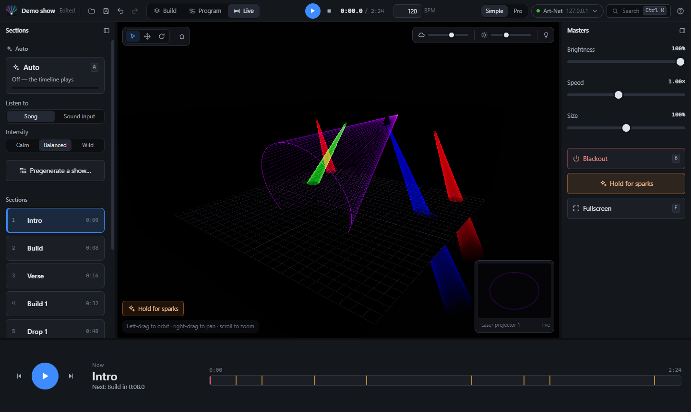

# Live

The **Live** workspace (Ctrl+3) is for performing. The 3D view fills the
middle; the controls are big and work from the keyboard.

## Section pads (left)

There's one pad for each marker on your timeline, plus **Start**. Click a
pad, or press **1–9**, to jump there. Press **← / →** for the previous or
next section.

No pads yet? Add markers in Program with **M** (see
[The timeline → Markers](04-the-timeline.md#markers)).

**Jump on** (Pro) makes a jump wait for the music:

- **Now** jumps straight away.
- **Next beat** waits for the next beat.
- **Next bar** waits for the next bar, so the cut lands on the downbeat.

Above the pads is **Auto** (see [Auto → Live Auto](07-auto.md#live-auto)).

## Masters (right)

| Control | What it does |
| --- | --- |
| **Brightness** | Scales every light and laser |
| **Speed** | Speeds every effect up or down (¼× to 2×) |
| **Size** | Laser size, and how far moving heads swing (0 to 2×) |
| **Blackout** (B) | Kills all light and laser output. Press again to bring it back |
| **Hold for sparks** | Fires every cold-spark machine while held |
| **Fullscreen** (F) | Fills the screen with the show |

**Double-click a fader** to reset it. Ctrl+K → "Reset masters" resets all
three.

Masters and blackout are for the performance only. They aren't saved with
the show and aren't undone.

## The bar (bottom)

- **Previous**, **Play / pause** and **Next**.
- What's playing **now** and what comes **next**.
- An overview of the song: click it to jump anywhere.

## Tips for a gig

- Press **F** for fullscreen on a second screen or projector.
- Keep a hand near **B**. Blackout works in every workspace.
- Hide the side panels with the buttons in their headers to give the show
  more room.
