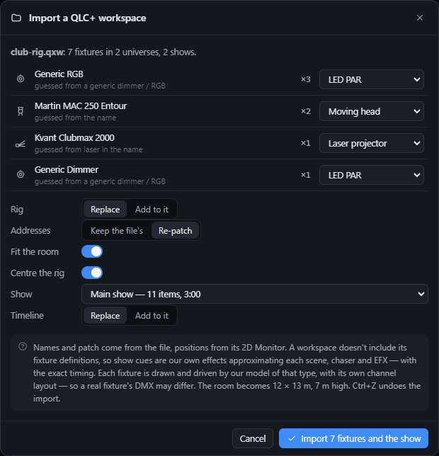

# Importing

Lightshow Studio can bring in work from other programs:

| File | From | What you get |
| --- | --- | --- |
| **ILDA** (`.ild`) | BEYOND, QuickShow, LaserOS and most laser software | Laser patterns, with their colours and animation |
| **MVR** (`.mvr`) | grandMA3, Vectorworks Spotlight, Capture, Depence and others | Your rig: positions, aim, names and patch |
| **QLC+** (`.qxw`) | QLC+ | Your rig, and a show from its Show Manager as timeline cues |
| **xLights** (`.xsq`) | xLights | A sequence's effects as cues on your rig, and a timing track as markers |

Every import is a single edit, so **Ctrl+Z undoes it**.

## ILDA laser files

In Program, open the **Imported** group at the end of the laser patterns
and click **Import ILDA file…**. You can also search "ILDA" with Ctrl+K. You
can pick several files at once (up to 20 MB each).

- Formats 0, 1, 2, 4 and 5 are read: 2D and 3D frames, with palette colours
  and true colour.
- Imported patterns keep **their own colours**. The cue's Colour tints them,
  and white leaves them as they are.
- Animated files play their frames in order. Set the speed with the cue's
  **Frame rate**.
- Imported patterns are **saved inside the show file**, so the show still
  works on another computer.
- To remove one from the show, click the **×** on its thumbnail. A pattern
  that cues still use can't be removed: change or delete those cues first.

## Rigs: MVR, QLC+ and xLights

In Build, click **Import (MVR, QLC+, xLights)…** at the bottom of the
library, or search "Import" with Ctrl+K. Pick the file and a dialog shows
what's in it.

### Fixture types

There's one row for each kind of fixture in the file, with its count. Each
kind is matched to one of our fixture types, and the row says why. Change any
of them with the menu. For xLights, you can also choose **Not imported**.

### Options

| Option | Choices |
| --- | --- |
| **Rig** | **Replace** removes your current fixtures first. **Add to it** keeps them |
| **Addresses** | **Keep the file's** universe and address, or **Re-patch** to the next free addresses |
| **Fit the room** | Resizes the room around the rig |
| **Centre the rig** | Moves it to the middle of the room |

Our fixture models have their own channel counts, so the file's addresses can
overlap. When they would, the dialog warns you and picks **Re-patch**.

### MVR

- Reads each fixture's position, aim, name and patch, including fixtures
  inside groups.
- The type is guessed from the fixture file inside the MVR (pan and tilt
  make a moving head) or from the name (laser, spark, batten, bar…).
- Lasers that the plot points straight at the floor face the audience
  instead, and spark machines stand on the floor.
- Trusses and other scene objects are counted but not imported.

### QLC+

- **The rig**: every fixture, with its name, universe and address. Positions
  come from QLC+'s 2D Monitor if you laid the rig out there. Otherwise the
  fixtures hang in rows by type.
- **A show**: pick one of the workspace's Shows (or none), and choose
  whether it **replaces** the timeline or is **added** to it. Every item
  lands at its exact time and length:
  - **Scenes** become a level and a colour.
  - **Chasers and Sequences** become a chase at the real step time.
  - **EFX** becomes a circle or wave movement.
  - **RGB Matrix** becomes a chase or a rainbow.
  - **Collections** become one look.
  - **Laser fixtures** get a laser track.
- The timing is exact, but the looks are an approximation in our own effects,
  because a workspace doesn't include its fixtures' definitions.

### xLights

- A sequence doesn't include its models, so the effects play on **your
  current rig**. Each model is matched to a fixture group by its name:
  - "MH" or "moving head" → moving heads
  - "flood" or "PAR" → PARs
  - "laser" → lasers
  - "spark" → cold sparks
  - anything else → pixel bars
- Each model becomes a track, and every effect a cue in its palette colours.
  Color Wash fades, Bars and similar effects chase, Twinkle flickers, VU
  Meter follows the bass, and Lasers become laser cues.
- **Markers**: pick a timing track, such as sections or lyrics. A "Beats"
  timing track also sets the BPM when no song is loaded.

### After importing a show

The song isn't inside a QLC+ or xLights file. A message names the song file
the show uses; load it in Program to play along.
