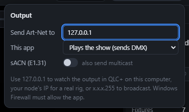

# DMX output

Lightshow Studio sends your show to real lights as **Art-Net**, and
optionally **sACN (E1.31)**, at a steady 40 times a second. It can also do
the reverse: **follow a lighting console**, so the 3D view becomes a
visualiser for a show you run from the desk.

> **Laser cues are visual only for now.** Fixture looks (moving heads, PARs,
> bars, battens, sparks) go out over DMX. Laser cues play in the 3D view but
> aren't sent to a real laser yet.

## The output pill

The pill in the top bar shows where DMX is going, for example **Art-Net
127.0.0.1**. Click it to open the output settings, or search "Output" with
Ctrl+K.

- **Send Art-Net to**: the IP address to send to.
  - `127.0.0.1` sends to this computer, for example to QLC+ running here.
  - Your Art-Net node's IP sends to a real rig.
  - An address ending in `.255` (such as `192.168.1.255`) broadcasts to
    the whole network.
- **This app** (Pro):
  - **Plays the show (sends DMX)** is the normal mode.
  - **Follows a console (previz)**: see below.
- **sACN (E1.31)** (Pro): also sends sACN multicast, alongside Art-Net.

Each universe in your patch is sent as the Art-Net universe with the same
number. Windows Firewall must allow the app to use the network.

## Check the output with QLC+

[QLC+](https://qlcplus.org) is free and shows DMX values live.

1. Set **Send Art-Net to** to `127.0.0.1`.
2. In QLC+, enable Art-Net input on universe 1 and open the **DMX Monitor**.
3. Play the show. The channels move at 40 Hz.

In the demo show, the four moving heads are at addresses 1, 10, 19 and 28
on universe 1, each using 9 channels (Pan, Pan fine, Tilt, Tilt fine,
Dimmer, Red, Green, Blue, Zoom).

## Follow a console

Switch **This app** to **Follows a console (previz)** (Pro). The app then
listens for Art-Net coming in, and your console's values drive the 3D
fixtures directly. Each incoming Art-Net universe drives the patch universe
with the same number. Patch the fixtures in Lightshow Studio at the same
addresses as on the desk.

While following, the timeline is paused and the pill reads **Following
console**.

## Fixture channels

| Fixture | Channels (in order from its start address) |
| --- | --- |
| Moving head | Pan, Pan fine, Tilt, Tilt fine, Dimmer, Red, Green, Blue, Zoom |
| LED PAR | Dimmer, Red, Green, Blue, Strobe |
| Pixel bar | Dimmer, then Red, Green, Blue for each of 8 cells |
| Wash batten | Dimmer, Red, Green, Blue |
| Laser projector | Dimmer, Red, Green, Blue, Speed, Spread |
| Cold spark | Trigger (above 127 fires), Height |

See the patch sheet in Build (Pro mode) for every fixture's universe and
address.

## USB DMX interfaces

USB interfaces such as the Enttec USB Pro aren't supported yet. Use an
Art-Net node, or a cheap Art-Net to DMX gateway, to reach 5-pin DMX
fixtures.
