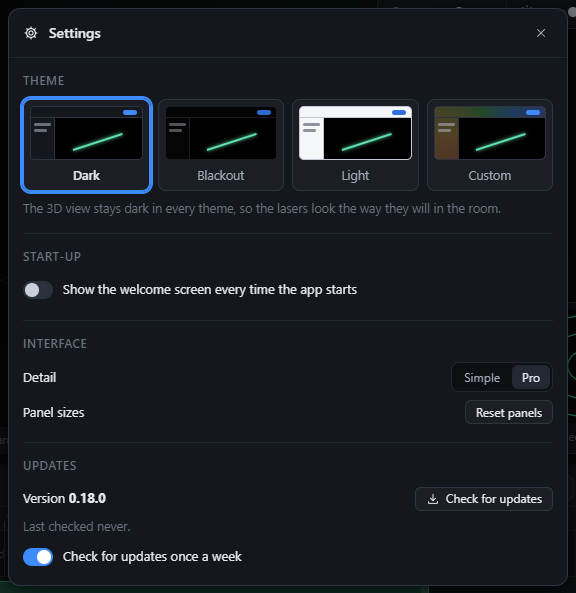
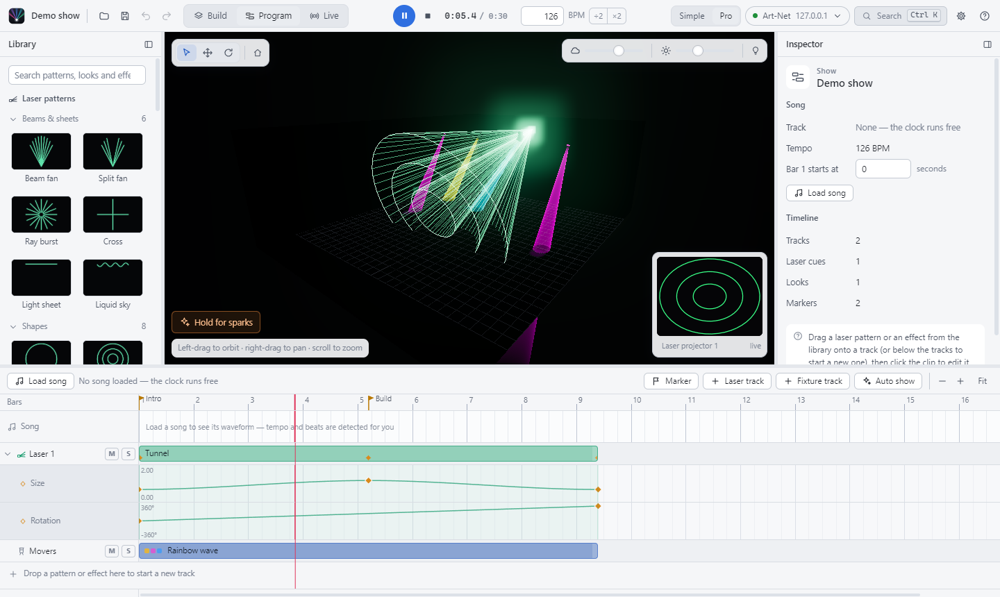
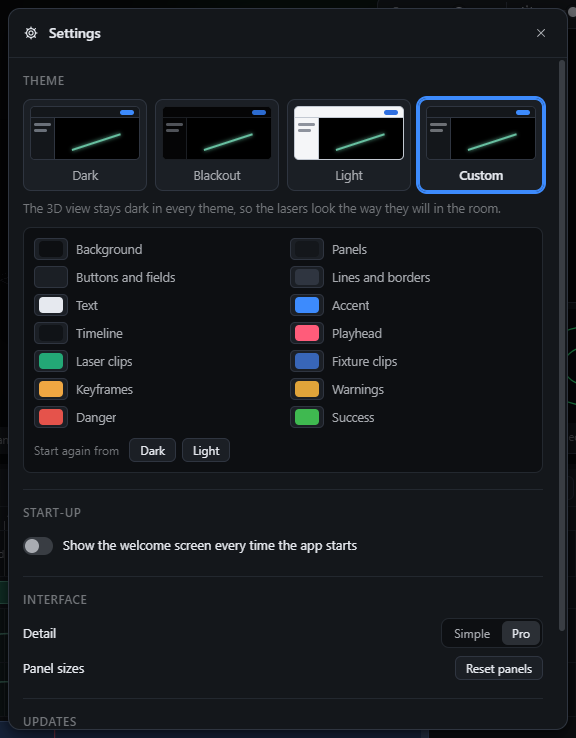
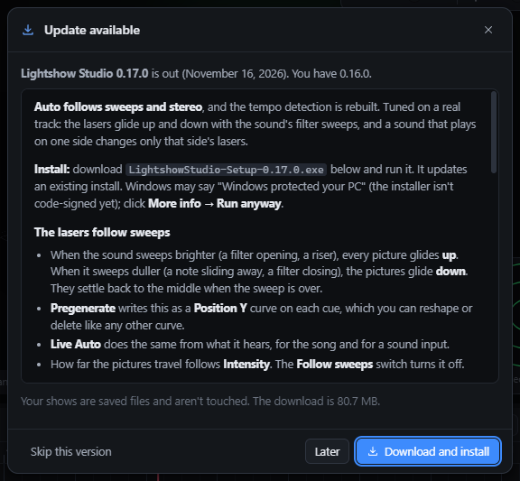

# Settings and updates

Settings holds the app's own preferences: the theme, what happens at
start-up, the interface and updates. Open it with the **gear** in the top
bar, **Ctrl+,**, or by searching "Settings" with **Ctrl+K**.

These are preferences for this computer. They aren't saved in your show
files, and every change applies at once.

## Theme

Pick how the app's panels look:

- **Dark** is the default.
- **Blackout** is almost black, for dark rooms and shows, so the screen
  doesn't light up the space.
- **Light** has pale panels, for bright rooms and daylight.
- **Custom** lets you choose the colours yourself (see below).

The 3D view, the laser preview and the pattern pictures stay dark in every
theme, so the lasers look the way they will in the room.

### Custom colours

Choose **Custom** and a set of colour boxes appears. Click one to pick its
colour; the app changes as you drag.

| Colour | Used for |
| --- | --- |
| Background | Behind everything |
| Panels | The library, the inspector, the timeline area |
| Buttons and fields | Buttons, text boxes, sliders |
| Lines and borders | Dividers and outlines |
| Text | Most writing |
| Accent | The selected thing, the main button in a dialog |
| Timeline | Behind the tracks |
| Playhead | The playhead line |
| Laser clips / Fixture clips | Laser and fixture cues on the timeline |
| Keyframes | Markers and keyframes |
| Warnings / Danger / Success | Warnings, Blackout and delete, "all good" |

The shades in between (hover colours, dimmer text) are worked out from
these. If you pick a light background, cue names on the timeline turn dark
and shadows get softer, so everything stays readable.

Gone too far? **Start again from Dark** or **Light** puts every box back to
that theme's colours.

## Start-up

**Show the welcome screen every time the app starts** opens the welcome
screen (Demo show, Empty venue, Open a show) at each start. It's off by
default: the app opens the demo show straight away.

## Interface

- **Detail**: the same **Simple / Pro** switch as in the top bar (see
  [Getting started](01-getting-started.md#simple-and-pro)).
- **Reset panels**: every workspace's panels go back to their first sizes,
  and any panel you hid comes back.

## Updates

Lightshow Studio checks for a new version **once a week**, a few seconds
after it starts. If there is one, a window shows what's new:

- **Download and install** downloads the new installer, with a progress
  bar. Then **Install and restart** closes the app and runs the installer,
  which opens the new version when it's done.
- **Later** closes the window. The weekly check asks again next week.
- **Skip this version** stops the weekly check telling you about this
  version. The next one still shows up, and **Check for updates** always
  shows the newest.

The weekly check never interrupts a show. While a song is playing, or the
Live workspace is open, the window waits until playback stops and you leave
Live.

**Your shows aren't touched** by an update; they are your own files. If the
show has unsaved changes, the update window offers **Save the show** before
it installs.

Windows may say **"Windows protected your PC"** when the installer starts,
because it isn't code-signed yet. Click **More info**, then **Run anyway**.

In Settings:

- **Check for updates** asks straight away, and tells you if you're up to
  date.
- **Check for updates once a week** turns the weekly check off and on.

The check asks GitHub, where the app is published, for the latest version.
It sends nothing about you or your shows.
