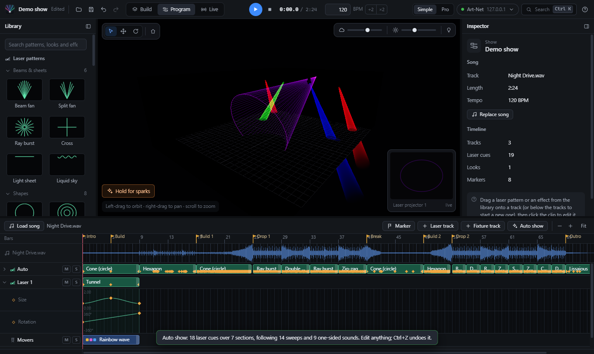

# Lightshow Studio user guide

Lightshow Studio is a light-show designer built for laser shows. You build
your rig in a hazy 3D venue, program a show to a song on a timeline, and
then play it live. It can also send DMX to real lights over Art-Net or sACN.

New here? Read the first two pages. The rest work as a reference you can
dip into.

## Contents

**Start here**
1. [Getting started](01-getting-started.md): install, the window, Simple and Pro, saving
2. [Your first show](02-your-first-show.md): from an empty venue to a show in ten minutes

**Reference**
3. [The rig (Build)](03-the-rig.md): fixtures, placing, mirrored pairs, the patch
4. [The timeline (Program)](04-the-timeline.md): songs, tracks, cues, markers
5. [Laser cues](05-laser-cues.md): patterns, Key Effects, keyframes, palettes, projectors
6. [Fixture looks](06-fixture-looks.md): looks, effects and how layers combine
7. [Auto](07-auto.md): Pregenerate a show from the song, or let Auto play it live
8. [Live](08-live.md): pads, masters, blackout and performing
9. [Importing](09-importing.md): ILDA, MVR, QLC+ and xLights files
10. [DMX output](10-dmx-output.md): Art-Net, sACN and following a console
11. [Settings and updates](11-settings.md): themes, start-up, checking for updates
12. [Keyboard shortcuts](12-shortcuts.md)
13. [Troubleshooting](13-troubleshooting.md)

## Opening this guide in the app

Press **F1**, or open **?** in the top bar and choose **User guide**. You can
also search for "guide" with **Ctrl+K**.
